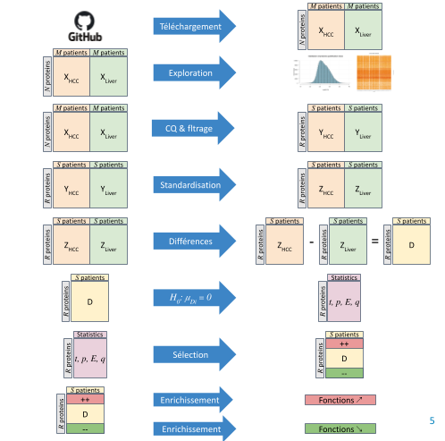

```{r settings, include=FALSE, echo=FALSE, eval=TRUE}
library(knitr)

options(width = 300)
# options(encoding = 'UTF-8')
knitr::opts_chunk$set(
  fig.width = 7, fig.height = 5, 
  fig.path = 'figures/canale23_',
  fig.align = "center", 
  size = "tiny", 
  echo = TRUE, 
  eval = TRUE, 
  warning = FALSE, 
  message = FALSE, 
  results = TRUE, 
  comment = "")

options(scipen = 12) ## Max number of digits for non-scientific notation
# knitr::asis_output("\\footnotesize")

```


## Abbreviations

| Abbreviation | Meaning |
|--------------|----------------------------------------|
| LFQ | Label-Free Quantification |
| log2 | base-2 logarithm |
| IQR | inter-quartile range |
| Q1 | First quartile |
| Q2 | Second quartile = median |
| Q3 | Third quartile |
| HCC | carcinome hépatocellulaire (tissu hépatique tumoral) |

## Cas d'étude

Nous analysons ici un jeu de données protéomiques de Canale et al. (2023), qui contient des mesures de l'abondance de 8192 protéines chez 35 patients souffrant d'un carcinome hépatocellulaire (HCC). 

Pour chaque patient, deux échantillons biologiques ont été prélevés :

- HCC : tissu hépatique tumoral de carcinome hépatocellulaire (34 échantillons)
- Liver : tissu non tumoral adjacent au carcinome hépatocellulaire (35 "échantillons )

Notons d'emblée que pour certains patients il manque l'une ou l'autres des observations, de sorte qu'il n'y a que 31 paires d'observations appariéés (prises sur le même patient). 


**Référence :**¨ Canale, F. P. et al. Proteomics of immune cells from liver tumors reveals immunotherapy targets. Cell Genomics 3, 100331 (2023). [doi.org/10.1016/j.xgen.2023.100331](https://doi.org/doi.org/10.1016/j.xgen.2023.100331)

Les tableaux de données et autre matériel supplémentaire sont disponibles sur le site Web du journal :

- www.cell.com/cell-genomics/fulltext/S2666-979X(23)00099-X

Les données brutes (que nous n'utiliserons pas pour ce cours) sont accessibles dnas la base de données protéomiques PRIDE : [www.ebi.ac.uk/pride/archive/projects/PXD040957](https://doi.org/www.ebi.ac.uk/pride/archive/projects/PXD040957)


## Objectifs et schéma de l'analyse

L'objectif du TP est de mettre en oeuvre une analyse afin de détecter les protéines dont l’abondance diffère entre les deux tissus, et d'analyser la fonction de ces protéines. 

L'organigramme ci-dessous schématise les étapes successives de cette analyse.

```{r organigramme, echo=FALSE, out.width="100%", fig.align="center", fig.cap="**Organigramme de l'analyse des données protéomiques.** Les étapes successives seront abordées dans des documents Rmarkdown séparés. "}

```

Le code et l'interprétation des résultats sont organisés en documents R markdown structurés pour effectuer successivement chacune de ces étapes. 

Ce document-ci fournit le code pour réaliser automatiquement le téléchargement des données de Canale (2023) à partir du dépôt github du cours, et les charger dans R. 

## Téléchargement des fichiers de données

Dans cette section nous fournissons le code pour télécharger les données à partir du dépôt github du cours et pour les installer dans un dossier spécifique sur votre ordinateur. 


```{r data_download}

## This  chunk of code below automatically performs the following operations
## 1. Define the working directory, check if it exists and if not create it
## 2. Define the data directory, check if it exists and if not create it
## 3. Download the proteomics data (quantification table) 
##    and metadata (protein names, sample groups) in the data directory. 
##    If the files are already present, the download is skipped. 

## Working dir 
working_dir <- "~/proba_stat_bio_TP/canale_2023"
dir.create(working_dir, recursive = TRUE, showWarnings = FALSE)
setwd(working_dir)
message("Working directory: ", working_dir)

#### Check data directory and create it if necessary ####
data_dir <- file.path(working_dir, "data")
dir.create(data_dir, recursive = TRUE, showWarnings = FALSE)
message("Data directory: ", data_dir)


## Define file names
files <- c("canale_2023_protein_log2-LFQ.tsv", 
           "canale_2023_protein-names.tsv", 
           "sample_groups.tsv")

## Download the data from github to the local data dir
repo_base <- "https://raw.githubusercontent.com/ProbaStatBio-AMU-SBGAU14L/proba-stat-bio_SBGAU14L/refs/heads/main/data/canale_2023/"


for (f in files) {
  ## Define the destination path (data dir + file name)
  dest_file <- file.path(data_dir, f)
  
  ## Check if the file is already there, and if so skip, else download it
  if (file.exists(dest_file)) {
    message("File ", f, " already here, skipping the download")
  } else {
    source_url <- file.path(repo_base, f)
    message("Downloading file ", f, " from github")
    download.file(source_url, dest_file, quiet = FALSE)
  }
}

```


| | |
|-----------------------|----------------------------------------------------|
| Working directory | `r working_dir` |
| Data directory | `r data_dir` |
| Files present in the data directory | `r list.files(data_dir)` |

## Chargement des données dans R


Nous chargeons dans R les 3 fichiers de données de départ fournis pour ce TP : 

| Fichier | Contenu |
|:----------------:|:-----------------------------------------|
| `canale_2023_protein_log2-LFQ.tsv` | quantification de l'abondance de chaque protéine (ligne) dans chaque échantillon (colonne). Les données sont fournies en unité log2(LFQ), qui résultent de la transformation logarithmique en base 2 des mesures LFQ (Label-Free Quantification). **Note:** la premièreb colonne du fichier TSV contient les identifiants des protéines, et la première ligne les identifiants des prélèvements.  |
| `canale_2023_protein-names.tsv` | Noms et descriptions des protéines (lignes). Les colonnes indiquent les identifiants de protéines, les noms de protéines et les noms de gènes. A noter : (1) une même protéine peut avoir un ou plusieurs ID différents selon les bases de données de référence; (2)  certaines n'ont aucun nom de protéine ou de gènes ; (3) certaines protéines ou gènes ont plusieurs noms (synonymes) | 
| `sample_groups.tsv` | correspondance entre les identifiants d'échantillons, les types de prélèvements (foie non-cancéreux ou carcinome hépatocellulaire), et les identifiants de patients (nombres). Pour cette analyse, le jeu de données ne contient que 2 groupes: **HCC**  (carcinomes hépatocellulaires) pour les prélèvements de carcinomes hépatocellulaires, et **liver** pour les prélèvements dans des tissus de foie non-tumoraux adjacents |

Les trois fichiers sont fournis en format "tab-separated values" (colonnes séparées par des tabulations), avec l'extension `.tsv`. 


```{r data_loading}
message("Loading the datasets")

#### Load the data file ####
log2_LFQ = read.delim(
  file = file.path(data_dir, "canale_2023_protein_log2-LFQ.tsv"), 
  sep="\t", 
  header=TRUE, 
  row.names=1)

## Load a separate table indicating which sample belongs to which group (cancer or liver cells)
sample_groups = read.delim(
  file.path(data_dir, "sample_groups.tsv"), 
  sep="\t", 
  header=TRUE, 
  row.names=1)

## Load the protein names from a separate table
protein_names = read.delim(
  file = file.path(data_dir, "canale_2023_protein-names.tsv"),
  sep = "\t",
  row.names = 1,
  header = TRUE
)
```

Les données que vous avez chargées à partir de ces fichiers sont stockées dans les variables R décrites ci-dessous.  

| Variable | Rows | Columns | Content | 
|-------------|-----|------|------------------------------------|
| `log2_LFQ` | `r nrow(log2_LFQ)` | `r ncol(log2_LFQ)` | Protein quantification table, in log2(LFQ), where LFQ stands for label-free quantification. One row per protein, one column per sample |
| `protein_names` | `r nrow(protein_names)` | `r ncol(protein_names)` | Protein identifiers, protein names and gene names. One row per protein |
| `sample_groups` | `r nrow(sample_groups)` | `r ncol(sample_groups)` | One row per sample, two columns inidicating its group and its patient identifier (number) |


Dans cette table, vérifiez que les dimensions sont cohérentes entre les tables qui fournissent des informations complémentaires. 

- le nombre de lignes de `protein_names` doit être identique à celui de `log2_LFQ` (une ligne par protéine)
- le nombre de ligne de `sample_groups` (une ligne par prélèvement) doit être égal au nombre de colonnes de `log2_LFQ` (une colonne par prélèvement)

Contrôlez également la correspondance entre les dimensions ci-dessus, qui correspondent aux données que vous avez chargées, et celles attendues indiquées ci-dessous. Si ces nombres ne correspondent pas, vérifiez que le téléchargement et le chargement se soient déroulés correctement. 

| Variable | Rows | Columns | Content | 
|-------------|-----|------|------------------------------------|
| `log2_LFQ` | 8182 | 69 | Protein quantification table, in log2(LFQ), where LFQ stands for label-free quantification. One row per protein, one column per sample |
| `protein_names` | 8182 | 5 | Protein identifiers, protein names and gene names. One row per protein |
| `sample_groups` | 69 | 2 | One row per sample, two columns inidicating its group and its patient identifier (number) |


## Assignation des couleurs aux groupes et aux échantillons

Le bloc de code suivant définit assigne une coleur à chaque groupe, et aux échantillons correspondants : 

- HCC : orange pâle
- Liver : vert pâle


```{r sample_colors}
#### Define colors per sample ####

## Check the correspondence between data and metadata
stopifnot(setequal(colnames(log2_LFQ),
                   rownames(sample_groups)))

## Reorder sample metadata to match the abundance table
sample_groups <- sample_groups[colnames(log2_LFQ), ,
                               drop = FALSE]

## Clean group labels
sample_groups$group <- trimws(as.character(sample_groups$group))

## Define one color per tissue type
group_colors <- c(
  HCC = "#FFDDCC",
  Liver = "#DDFFDD"
)

## Check group labels
stopifnot(all(sample_groups$group %in% names(group_colors)))

## Assign a color to each sample
sample_groups$color <- unname(
  group_colors[sample_groups$group]
)

## Check color assignment
table(sample_groups$group, sample_groups$color,
      useNA = "ifany")
```


## Sélection des données appariées

Le bloc de code ci-dessous filtre les données en écartant les patients pour lesquels on ne dispose pas des deux observations (Liver et HCC). Cette étape est nécessaire pour pouvoir mener l'analyse de données appariées. 

```{r select_paired_sample, echo=FALSE, results=FALSE}
#### Select paired samples ####

## Count samples per patient and tissue type
samples_per_patient <- table(
  sample_groups$group,
  sample_groups$sample
)

## Select patients with exactly one sample of each tissue type
paired_patients <- colnames(samples_per_patient)[
  samples_per_patient["HCC", ] == 1 &
  samples_per_patient["Liver", ] == 1
]

## Select sample metadata for paired patients
sample_groups_paired <- subset(
  sample_groups,
  sample %in% paired_patients
)

## Select the corresponding columns of the proteome table
log2_LFQ_paired <- log2_LFQ[
  , rownames(sample_groups_paired), drop = FALSE
]

## Check consistency between data and metadata
stopifnot(
  identical(colnames(log2_LFQ_paired),
            rownames(sample_groups_paired)),
  identical(rownames(log2_LFQ_paired),
            rownames(protein_names))
)

## Check the number of samples per patient
table(sample_groups_paired$group,
      sample_groups_paired$sample)
```


Nous exportons les tables de données appariées dans le dossier `r data_dir`.

```{r export_paired_samples}

#### Export paired datasets ####
write.table(
  log2_LFQ_paired,
  file = file.path(data_dir,
                   "canale_2023_protein_log2-LFQ_paired.tsv"),
  sep = "\t",
  quote = FALSE,
  row.names = TRUE,
  col.names = NA
)

write.table(
  sample_groups_paired,
  file = file.path(data_dir,
                   "sample_groups_paired.tsv"),
  sep = "\t",
  quote = FALSE,
  row.names = TRUE,
  col.names = NA
)
```


## Questions pour l'étape de chargement des données

Répondez sous les questions, et compilez le rapport avec knitr (format html, pdf ou word selon vos préférences). 

1. Quelles sont les dimensions de la matrice de données ?

    - 8181 lignes x 69 colonnes

2. Que représentent les lignes et les colonnes ?

    - Lignes : protéines
    - Colonnes : prélèvements

3. Combien y a-t-il de protéines,  de prélèvements tissulaires et de  patients dans le tableau de départ ?

    - `r nrow(log2_LFQ)` protéines
    - `r ncol(log2_LFQ)` prélèvements tissulaires
    - `r length(unique(sample_groups$sample))` patients

4. Pour combien de patients dispose-t-on des deux types tissulaires ?

    - `r ncol(log2_LFQ_paired)/2`` patients

5. A quoi correspondent les valeurs numériques dans le tableau ?

    - `log2(LFQ)`, qui résulte de la transformation logarithmique en base 2 des mesures LFQ ( Label-Free Quantification), obtenues en mesurant la surface sous les pics de spectrométrie de masse. 

6. A quoi correspondent les valeurs manquantes ?

    - des protéines dont l'abondance est trop faible pour être détectées, ou pour laquelle on a rencontré des difficultés tehcniques dans le traitement ultérieur de leur mesure. 

## Sauvegarde des données pour les étapes suivantes

Afin de faciliter la réalisation des étapes suivantes de l'analyse, nous sauvegardons dans un fichier au format `RData` les principaux objets R générés au cours de cette première étape. Ce format permet de sauvegarder plusieurs objets R dans un même fichier, en conservant leurs noms, leurs types et leurs structures.

Nous pourrons ainsi charger directement ces objets au début de l'étape suivante, sans devoir télécharger et charger à nouveau les fichiers de données originaux.

Les fichiers de sortie de chaque étape sont également disponibles sur le dépôt github du cours, pour vous vous permettre de démarrer une étape dans les bonnes conditions, même si vous avez rencontré des difficultés au cours de l'étape précédente. 

```{r save_data}

#### Save R objects for the next step ####

## Define the output file
Rdata_dir <- file.path(data_dir, 'Rdata')
dir.create(Rdata_dir, showWarnings = FALSE, recursive = TRUE)
RData_file <- file.path(Rdata_dir, "01_data-loading.RData")

## Save the relevant R objects
save(
  log2_LFQ,
  sample_groups,
  protein_names,
  log2_LFQ_paired,
  sample_groups_paired,
  paired_patients,
  group_colors,
  file = RData_file
)

## Report the location of the saved file
message("R objects saved in: ", RData_file)

```

Les objets R sont maintenant sauvegardés dans le fichier
`r RData_file`.

Ils pourront être restaurés au moyen de la fonction `load()`
au début du prochain document R Markdown.


